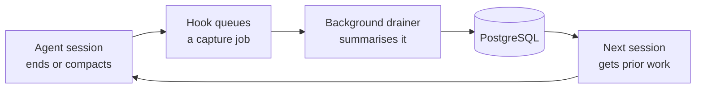

# Khipu

**Khipu gives AI coding agents a memory that outlives the session.**

The name comes from Andean knotted-cord records (*khipu*): memory encoded as structure, not as a pile of chat transcripts.

## What it is

Every coding agent forgets. Close the window and the decisions, the constraints and the approaches you already ruled out are gone.

Khipu is a Mac app, a Python CLI and a set of agent integrations. It captures what happened in an agent session, stores it in PostgreSQL as searchable prose plus a knowledge graph, and puts it back in front of the agent when it is relevant. It works across machines.

## Who it is for

People who use coding agents every day, on one Mac or several, and want the agents to remember. It is a personal system: one database, your machines, your agents.

## What it does

- **Capture.** Hooks in your agents queue a capture after about five user turns or twenty minutes, and always at compaction or session end. A background step summarises each window and writes it to the database.
- **Recall.** Prior work is pushed into context at session start and on each prompt (Claude Code and Codex). Agents and you can also search by best match, exact words or meaning, or walk the graph.
- **Commitments.** Open loops from sessions become an Owed list you can close, reopen or snooze.
- **Decisions.** A registry tracks which decisions still stand, and which were superseded or retracted.
- **Briefs and reflect.** Optional, off by default: source-backed topic briefs, and answers from memory that cite their sources.
- **Libraries.** Index a folder of `.txt` and `.md` files as another search space.
- **Routing and plan usage.** Shows each subscription account's headroom and state. Khipu reports; routing stays with you.
- **Desktop app.** Home, Recall, Owed, Activity, Harnesses and Settings, plus a first-run setup flow.
- **Multi-Mac and gateway.** Join another Mac with a join kit. An HTTPS gateway serves cloud agents that cannot reach the database, such as Grok Bot.
- **Backups.** Health checks for backups and restore drills, an offline copy of memory, and local data backup and restore.

Supported agents: Claude Code, Cursor, Codex and Aegis locally, and Grok Bot through the gateway. Claude accounts run inside T3 Code are covered by the Claude Code install.

Planned: a Work view and work ledger, gateway provenance, and a settings clarity pass.

## Install

Requires macOS 12 or later on Apple silicon.

1. Download the latest `Khipu_*.dmg` from the [GitHub releases page](https://github.com/mrkinglollipop/Khipu/releases/latest).
2. Open the DMG and drag **Khipu.app** to **Applications**.
3. Launch Khipu.

The app checks GitHub Releases at launch. Install an update from Settings, then Updates, then Check for updates. If macOS blocks a release that is not notarized, right-click **Khipu.app** and choose **Open** once.

## First run

The first launch opens a six-step setup: Welcome, Database, Model, Graph, Agents, Finish. Each step checks itself, so you can stop and resume.

- **Database.** Choose one: join a Khipu you already have, set up a new database on this Mac (needs Docker), or connect to a database you already run.
- **Model.** Pick the summariser: cloud Gemini, Claude Haiku with an API key, Claude or ChatGPT on your own login, or a local OpenAI-compatible endpoint. You can skip this for now.
- **Graph.** Installs the graph builder. You can skip it and do it later in Settings.
- **Agents.** Lists the agents it found. Install and verify each one in Harnesses.
- **Finish.** Runs a health check and lists anything unresolved, each with one fix.

Details are in [docs/setup.md](docs/setup.md).

## Learn more

| Topic | Page |
| --- | --- |
| How capture, storage and recall work | [docs/how-it-works.md](docs/how-it-works.md) |
| Setup, step by step, and self-hosting | [docs/setup.md](docs/setup.md) |
| Every CLI command | [docs/cli.md](docs/cli.md) |
| The MCP tools agents use | [docs/mcp-tools.md](docs/mcp-tools.md) |
| Agent integrations and hooks | [docs/integrations.md](docs/integrations.md) |
| The desktop app | [docs/desktop-app.md](docs/desktop-app.md) |
| Routing and plan usage | [docs/routing.md](docs/routing.md) |
| Health checks, jobs, backups, gateway | [docs/operations.md](docs/operations.md) |
| Questions and answers | [docs/faq.md](docs/faq.md) |

For contributors: [CONTRIBUTING.md](CONTRIBUTING.md). Package READMEs: [packages/cli](packages/cli/README.md) and [apps/desktop](apps/desktop/README.md).

## Support

Email [support@kinglollipop.com](mailto:support@kinglollipop.com) for help, questions or a commercial licence conversation. If something is broken, include the output of `khipu doctor` and which agent you were using. Read it before you send it: doctor output includes recent capture summaries, paths and error text, and it is not redacted, so remove anything private. Bugs and feature requests are welcome as GitHub issues. Report security problems by email or through [GitHub's private advisory form](https://github.com/mrkinglollipop/Khipu/security/advisories/new), not a public issue.

## Licence

Khipu is licensed under the [GNU Affero General Public License v3.0](LICENSE). A modified version must also be released under AGPL-3.0, and that includes running it as a hosted service. For a commercial licence, contact the maintainer.

Contributions are covered by the same licence plus a [Contributor Licence Agreement](CLA.md). See [CONTRIBUTING.md](CONTRIBUTING.md).

The Khipu name and icon are not covered by the licence and remain the maintainer's marks.
