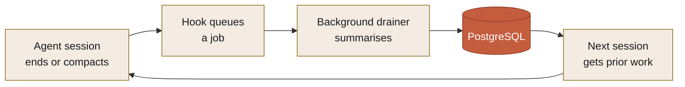
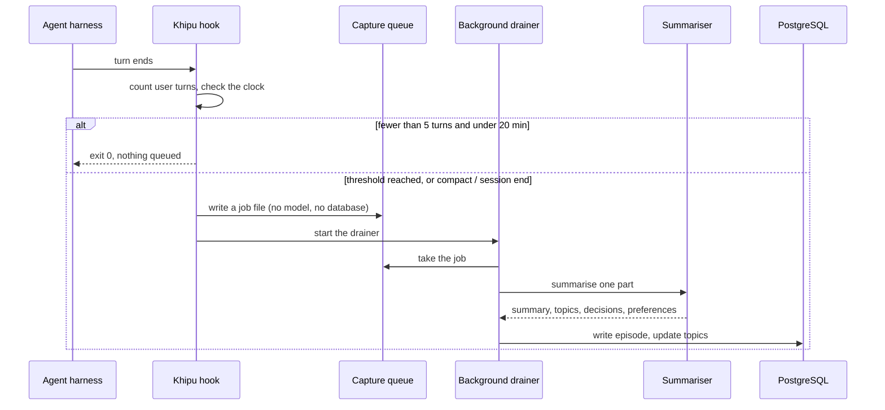
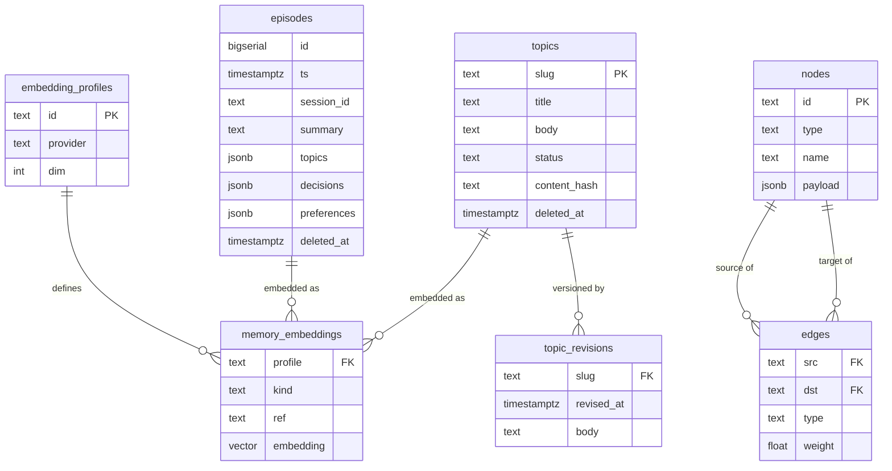
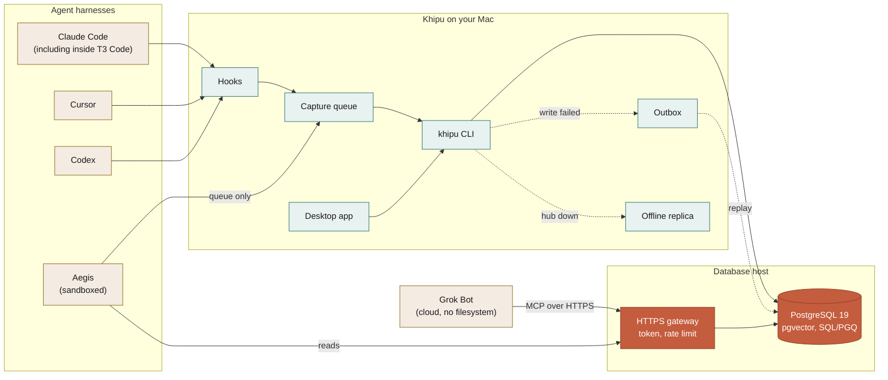
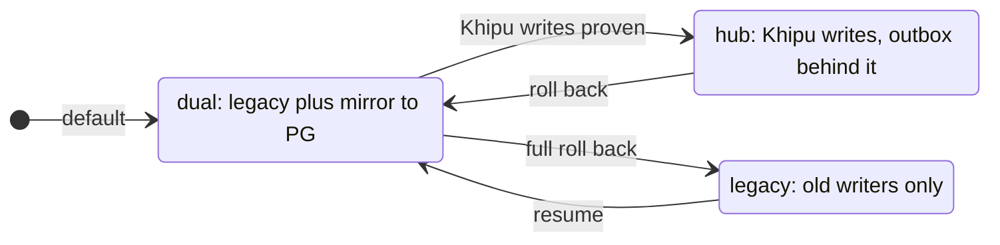

# How Khipu works

This page goes deeper than the [README](../README.md). It covers how a session becomes memory, what gets stored, how recall finds it again, where each piece runs, and how Khipu keeps its copies honest.

For setup steps see [setup.md](setup.md). For every command see [cli.md](cli.md). For the agent tools see [mcp-tools.md](mcp-tools.md).

## The short version



Capture is automatic. Storage is central and shared. Recall is both pushed (hooks put the most relevant prior work in front of the agent) and on demand (agents can search any time).

## 1. Capture: how a session becomes memory

Each harness gets small hook scripts. They run on session events and do almost nothing most of the time. Their job is to decide whether enough has happened to be worth a model call.



### When a capture is due

A capture is due after five user turns or twenty minutes, whichever comes first. It is always due at a compaction and at a session end. A window under 200 characters is never summarised.

The first time Khipu sees a transcript it starts a clock and reads from near the end of the file. A one-question session is therefore not captured on its first Stop.

### The queue and the drainer

The hook inside the session only writes a job file. It calls no model and no database. A detached drainer then picks up the jobs, runs the summariser, writes to PostgreSQL, mirrors, replays the outbox and catches up embeddings. Up to four drainers run at once by default.

A queue-drain job also runs every five minutes, so a job whose drainer was interrupted still finishes.

### Long windows are split, not cut

Each summariser call carries at most 14,000 characters. A longer window is split on message boundaries into several parts. Each part is its own job, its own summariser call and its own episode. Nothing is dropped by default. An owner can opt in to keeping only the newest parts with `KHIPU_CAPTURE_MAX_PARTS`.

Spend is bounded by daily call ceilings, one each for summariser calls, memory embedding and library embedding. A ceiling delays work. It does not drop captures. See `khipu budget status` and `khipu budget lift` (the ceiling can always be lifted).

### Which model summarises

The summariser is the `synth` role. Gemini (`gemini-2.5-flash`) is the default. You can switch to:

- Anthropic (default model `claude-haiku-5-5`)
- OpenAI
- OpenRouter
- a local OpenAI-compatible endpoint
- the `claude` or `codex` command line on your own login (Khipu holds no credential for these)

Use `khipu models show` and `khipu models set --role synth --provider ...`. API keys live in the Keychain. If another provider fails, `synth_fallback` can retry once on Gemini.

Transcript windows go to whichever provider you configure. One default to know: when a provider other than Gemini, `cloud` or `local` fails a window (an account limit, not logged in, a transport error, or a reply that is not capture JSON) and a Gemini key is configured, that window is retried once on Gemini Flash, so its text goes to Google. `synth_fallback` defaults to `gemini`; set it to `none` (`khipu config --set synth_fallback none`, or the fallback setting in the app) to leave the job queued instead.

### Two queues, two meanings

- The **capture queue** holds sessions that are not summarised yet.
- The **outbox** holds summaries whose database write failed. They replay when the database is back.

`khipu doctor` reports red while anything sits in the outbox, so a silent backlog is not possible.

### Heartbeats

Every hook run stamps a heartbeat per harness. This lets Khipu tell "the hook is broken" from "you have not used that harness lately". A claim about what a component is doing has to rest on evidence that it ran.

### Capture identity

Each episode can now record where it came from. Migration `0027_episode_sources.sql` adds an `episode_sources` table. A `source_key` is a hash of the harness, session, transcript range, window and part. When the session or transcript range is missing, a hash of the payload is used instead. Each row is an `origin` row (the capture that created the episode) or a `merged` row (a capture folded into it).

The migration backfills one row per existing episode. New captures and merges add rows as they go (a fail-open dual write). Nothing in the capture path reads the table yet, and uniqueness is still `(ts, md5(summary))`. Moving readers and uniqueness onto `source_key` is planned.

### Merging near-duplicates

If a new capture closely matches an episode within five minutes of it, it merges into the earlier one. An identical window is skipped outright. Otherwise the match uses cosine similarity (setting `dedup_similarity`, default 0.92) or, as a fallback, word overlap. The merged episode keeps receipts in its raw metadata, and the source rows are recorded in `episode_sources`.

## 2. Storage: what gets written

The core of the schema:



Two shapes carry most of the memory:

| | What it is | Written by |
|---|---|---|
| **Episodes** | What happened in one session window, with decisions and preferences pulled out. Near-duplicates merge. | Capture |
| **Topics** | A living page per subject, rewritten as understanding improves. Every version is kept in `topic_revisions`. | Capture, plus edits |

Topics carry a `content_hash` and a revision trail because they change constantly.

The **graph** (`nodes` and `edges`) sits alongside as a PostgreSQL 19 SQL/PGQ property graph named `alzy_graph`. A one-hop walk reads the direct edges and adds a best-effort SQL/PGQ `GRAPH_TABLE` sample. Deeper walks use a recursive query.

### Other record types

The schema has 28 migrations (`0000` to `0027`). Beyond episodes, topics and the graph, it holds:

| Record | What it is |
|---|---|
| Commitments | Things you still owe on a project (see section 4) |
| Decisions | A registry with a lifecycle and links between decisions (see section 4) |
| Briefs | Source-backed summaries of a topic (see section 4) |
| Library sources | Folders of text and Markdown files, indexed as a search space (see section 3) |
| Media assets | PNG and JPEG files embedded for search |
| Embedding profiles | Which model and size produce vectors, and which profile is active |
| Episode sources | Where each episode came from (capture identity, above) |

### Embedding profiles

Vectors live in `memory_embeddings`, keyed by profile. A profile id looks like `model@dim`. Providers are Gemini, Voyage and OpenAI-compatible endpoints. The largest indexed size is 2000 dimensions.

Only one profile is active. `khipu embed activate` refuses to switch to a profile with incomplete coverage unless you force it. Embeddings are keyed by content hash, so re-embedding only touches text that changed. Manage profiles with `khipu embed profiles` or in Settings, Embeddings.

### Deletions are tombstones

Topics and episodes are never silently dropped. Both carry a `deleted_at` column. Section 4 covers `forget`. Purging a tombstoned topic needs an explicit `--yes`.

## 3. Recall: pushed and on demand

### Pushed

Hooks put prior work in front of the agent before it acts.

- **Session start** (Claude Code, Codex, Cursor): the recall rule plus a slice scoped to the current project (open commitments, recent episodes, linked topics), plus, when the `routing_push` switch is on (it is off by default), the routing summary. See [routing.md](routing.md). The slice also lists standing decisions from the last 14 days.
- **Every prompt** (Claude Code and Codex): a bounded search on the prompt itself. It pushes at most three hits under a "Prior work on this topic" heading, capped at 600 characters. It has a 1.2 second budget, skips trivial prompts, and skips hits already shown in the last three prompts. It calls no summariser or chat model. When an embedding profile is active and the prompt's vector is not already cached, it makes one embedding call (secrets masked first), so the prompt text goes to that profile's embedding provider. It reads the local replica first and does not search libraries. If anything fails it returns nothing.
- **Aegis** gets no push. Its hooks run as observers and their output is discarded. Aegis agents pull with `khipu_status` and `khipu_owed`.
- **Cursor** gets the session-start push and a project rule file, but no per-prompt hook.

A warm local recall service (`khipu recall serve`) answers the per-prompt hook over a socket so each prompt skips a cold Python start. It is an optional launch job. Without it the hook uses a one-shot path.

See [integrations.md](integrations.md) for what each harness gets.

### On demand

```bash
khipu search "why did we pick pgvector"                  # hybrid (default)
khipu search "why did we pick pgvector" --mode literal   # exact words
khipu search "why did we pick pgvector" --mode semantic  # meaning
khipu graph <node-id> --hops 2                           # connections
```

**Hybrid** is the default. It fuses three signals by reciprocal-rank fusion: cosine neighbours from the active embedding profile, token overlap over the same embedded text, and a literal match. With no active profile it falls back to literal plus token overlap and marks the result `degraded`.

**Literal** mode ranks one pool across all kinds: phrase match first, then how many tokens hit, then recency. Use it for exact strings, ids and error messages. Graph nodes are left out unless you ask for `--kind node` or the query looks like an id.

**Semantic** mode uses cosine plus token overlap only. `--semantic` still works as a deprecated alias.

Two optional stages sit behind feature switches, both off by default: a rerank pass (one model call over 12 candidates) and an absolute relevance floor. See `khipu features`.

**Filters** work in the CLI and the MCP tool: `--kind` (episode, topic, node, media, library), `--source` (one library), `--project`, `--since`, `--until` (ISO dates or `7d`), `--session-id`, `--harness`, `--via`.

**Graph** walks expand the neighbourhood of a node. A topic slug works as an id. A digit id is an episode, and its neighbourhood is that capture's topics.

### Libraries

A library is a folder of `.txt` and `.md` files indexed as its own search space. Files up to 64 MiB are read. Libraries appear in default search as the `library` kind, and `--source` names one. Ids look like `library:<name>:<doc>#<chunk>`. Create and manage them with `khipu library`. Vectors can be computed elsewhere and imported. The offline replica holds no libraries, so library search needs the database.

### Loading a hit and paging

Search returns short teasers. `khipu get` and `khipu_get` load the whole record:

- An episode: its summary, decisions, preferences and topics.
- A topic: the body in pages of UTF-8 bytes. The default page is 64 KiB and the largest is 512 KiB. Follow `body_next_offset` until `complete` is true. `khipu get --all` loops for you.
- Media: path, hash and type.
- A library chunk, with its neighbouring chunks.

Every frame Khipu writes on these paths is strict UTF-8 JSON. U+2028 and U+2029 are escaped so line-based readers cannot cut a frame in two. In the other direction, Khipu splits its JSON Lines files and logs on LF only, so those characters inside a note cannot break one record into two.

### The offline replica

When the database is unreachable, reads fall back to a local SQLite copy (`hub_snapshot.sqlite`). It holds episodes, topics, revisions, nodes, edges, embedding profiles, vectors, decisions and deliverables. It does not hold libraries or commitments. Keyword search uses a trigram index there. Semantic search offline works only when the embedding provider is a local one.

How it stays fresh:

1. A nightly job rebuilds it. You can also run `khipu snapshot refresh`.
2. Between rebuilds, capture, edits, decisions and forget update it as they happen.
3. `doctor` and `status` report freshness per table as fresh, behind, stale or unknown. Only stale turns `doctor` red. A stale result carries a `stale: true` flag.

A scheduled incremental sync is planned.

## 4. What Khipu tracks beyond episodes

### Owed (commitments)

Open loops from a capture become commitments: follow-up, blocker, question or promise. A later capture in the same project can close them (a closed loop, a decision, or a "done:" line). A follow-up or promise with no due date goes stale after 14 days. A blocker or question goes stale after 30. A snoozed commitment is never stale before its date.

Use `khipu owed` (list, `--close`, `--reopen`, `--snooze`), the Owed screen, or the `khipu_owed` tools. Nightly steps mark stale ones and re-judge open ones.

### Decisions

Decisions are a registry with a lifecycle: supersede, restore, retract. Possible links between decisions wait as candidates until you confirm or reject them. Each decision keeps its evidence and reasons.

One validity module gives each result a state: current, mixed, superseded, retracted or unknown. Topics marked superseded, retired or abandoned rank lower. They are not excluded. Use `khipu decisions` or the `khipu_decisions` tools. Automatic supersession (`auto_supersede`) and validity ranking (`validity_ranking`) are feature switches and default off.

### Briefs

A brief is a source-backed summary of a topic. Every claim cites episode ids. Citations to episodes that were not offered are removed, and a claim left with no valid citation is dropped. A failed build never replaces the current brief. A brief goes stale when its sources change or a cited episode is forgotten.

Briefs are off by default. Turn on the `briefs` switch, then use `khipu briefs plan|build|show` or `khipu_brief`.

### Reflect

`khipu reflect "question"` answers from memory with citations. It abstains rather than answer without sources. It writes no memory and has a 20 second deadline. It is off by default and needs the `reflect` switch. The agent tool is `khipu_reflect`.

### Forget

`khipu episode forget ID` tombstones one episode. It does not erase the row: it sets `deleted_at`, and the summary and its provenance stay in the `episodes` table. Search, `khipu_get` and the episode detail view skip it. Today some recent-capture lists do not: the Activity list (`khipu activity` and the app's Activity screen), the `recent_captures` section of `khipu doctor`, `khipu status` and the full `khipu_status`, and the session-start slice when it falls back to recent captures can still show a forgotten episode's summary. A fix is planned. It also removes the episode's vectors, closes the commitments it opened (reason `forgotten`; the closed rows stay), retracts its decisions, deletes its deliverables, removes its lines from the legacy file and Khipu's own forget backups, updates the local replica, and marks briefs that cited it stale. Graph topic nodes are shared across episodes and are left alone, and database backups made before the forget still contain it. The legacy file and local replica steps can fail; capture jobs still waiting in the outbox are not removed, only reported. If anything is left, the result says `complete: false` and lists it under `partial`.

`khipu episode edit ID --summary "..."` corrects an episode and re-embeds it. `khipu topic purge SLUG --yes` hard-deletes a topic that is already tombstoned. In the app, use Activity.

## 5. Where it runs



Five integration packs exist (`claude_code`, `cursor`, `codex`, `aegis`, `grok_bot`):

- **Claude Code, Cursor and Codex** run on your Mac and reach PostgreSQL directly over your private network. They need no gateway.
- **Aegis** runs in a sandbox that cannot reach the database or the Keychain. Its hook only queues. A drain outside the sandbox does the summarising and the write. Aegis reads memory through the gateway.
- **Grok Bot** runs on a cloud VM with no filesystem. It reaches Khipu only through the gateway.

Claude accounts run inside T3 Code are wired by the Claude Code install, one set of hooks per Claude home. Search can filter by T3 thread. Stock Grok Build has no pack of its own.

Khipu never opens the database to the internet itself; keep it on a private network. The gateway is the only part meant to face the internet, and it enforces a bearer token, a request body cap, rate limits per address and per token, an auth-failure throttle, a JSON-RPC batch cap, and refusal of browser origins unless allowed. Over the gateway, `khipu_capture` writes immediately (there is no hook), and usage and routing answer "not available".

Install and check a harness with `khipu integrations install <harness>` and `khipu integrations verify <harness>`. Verify exercises the integration. It does not just check that a file exists.

Scheduled jobs on the Mac: a nightly memory run, a graph build, a monthly run, a notes watcher and the five-minute queue drain. The warm recall service is opt-in. See [operations.md](operations.md).

## 6. Nothing is cut over irreversibly

Khipu replaced a working file-based system, so the migration is reversible at every step. `capture_mode` is a setting, not a pipeline.



| Mode | In the app | Behaviour |
|---|---|---|
| `legacy` | Files only | Existing capture scripts only. Full rollback. |
| `dual` | Files and Khipu | Legacy capture continues and mirrors into PostgreSQL. The default. |
| `hub` | Khipu only | Khipu owns writes, with the outbox behind it. |

Change it in Settings, Capture & models, or with `khipu config --set-capture-mode`. The app control is locked when `KHIPU_CAPTURE_MODE` is set in the environment.

Reads moved to PostgreSQL first. Writes stayed on the proven path until capture, outbox and parity checks all worked. Switching to `hub` deletes nothing.

## 7. Keeping the copies honest

During the migration, memory exists as files and as database rows, so they can disagree. These commands stop that going unnoticed:

| Command | What it does |
|---|---|
| `khipu reconcile` | Sweeps files into PostgreSQL. Idempotent: it upserts on `(ts, md5(summary))`, so re-running never duplicates. It tombstones topics whose files were deleted (with a circuit breaker) and restores ones that reappear. |
| `khipu doctor` | The single health command. It checks drift in one direction: every file episode must exist in PostgreSQL. It also covers many more checks. |
| `khipu revisions` | Shows conflicting topic edits across machines. The newest edit wins and the older version is kept. |
| `khipu sources` | Lists, enables, disables, adds and removes graph roots. `sources export` writes the file graphify reads. |

`khipu doctor --quick` runs all the local health checks (imports, config, outbox, capture liveness, jobs, backups, launchers and more) and leaves out the hub, network and probe checks. `khipu doctor --probe` runs a fresh end-to-end recall test.

For the full list of checks, backups and the promotion gate, see [operations.md](operations.md). For common questions see [faq.md](faq.md).
